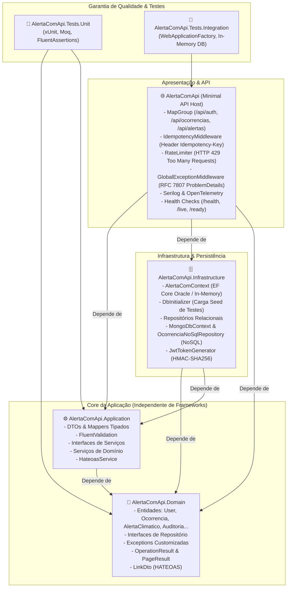

# 🚨 AlertaCom API - Plataforma CitizenTech de Prevenção & Zeladoria Urbana
> **Advanced Business Development with .NET - Global Solution FIAP 2026/2**  
> *Tecnologia com o Cidadão no Centro da Inovação*

---

## 👥 Integrantes do Grupo

| Nome | RM | Papel no Projeto |
|---|---|---|
| **Thomas Fontes** | **562254** | **Backend .NET & Mobile Application Development** |
| **Gabriel Maciel** | **562795** | **Java Advanced (Spring Boot & Pitch)** |
| **Matheus Molina** | **563399** | **Disruptive Architectures (Visão Computacional & GenAI)** |
| **Vitória Rodrigues** | **565160** | **Database (Oracle PL/SQL & MongoDB)** |

---

## 📌 1. Visão Geral da Solução

O **AlertaCom API** é uma solução corporativa desenvolvida em **.NET 10** (C#) aplicando os padrões arquiteturais mais modernos: **Clean Architecture**, **Minimal APIs**, **Repository Pattern**, **OperationResult**, **PageResult**, **HATEOAS**, **Idempotência de Requisições**, **Rate Limiting nativo (HTTP 429)**, persistência híbrida (**Oracle Database Relacional** via Entity Framework Core e **MongoDB NoSQL** com MongoDB.Driver), **Autenticação JWT Bearer**, **Observabilidade completa (Serilog, OpenTelemetry e Health Checks)** e uma suíte completa de **testes automatizados (xUnit)**.

A plataforma centraliza a gestão de riscos climáticos e zeladoria urbana, permitindo que cidadãos registrem ocorrências (alagamentos, bueiros obstruídos, quedas de árvores), acompanhem o atendimento e recebam alertas emitidos pela Defesa Civil.

---

## 🏗️ 2. Arquitetura da Solução (Clean Architecture)

A solução é dividida rigorosamente segundo a Clean Architecture:



---

## 🚀 3. Requisitos Atendidos da Global Solution

| Requisito | Pontos | Como foi implementado |
|---|---|---|
| **01. Minimal API RESTful & Swagger** | 20 pts | Endpoints mapeados via `MapGroup` (`/api/auth`, `/api/ocorrencias`, `/api/alertas`), validações via FluentValidation, paginação (`PageResult`) e HATEOAS (`links`) em todos os recursos, códigos HTTP semânticos e Swagger/OpenAPI com Bearer Token. |
| **02. Autenticação & Autorização JWT** | 20 pts | Proteção de rotas com JWT Bearer, claims de roles (`Cidadao`, `DefesaCivil`, `Admin`) e dados contextuais (bairro, CPF). |
| **03. Idempotência em Requisições** | 15 pts | Middleware `IdempotencyMiddleware` interceptando o cabeçalho `Idempotency-Key`. Evita duplicações em conexões instáveis do app e retorna `X-Idempotent-Replay: true`. |
| **04. Rate Limiting Funcional** | 15 pts | Middleware nativo de Rate Limiting com `FixedWindowLimiter` e resposta padronizada RFC 6585 com status `HTTP 429 Too Many Requests`. |
| **05. Testes Unitários e Integração** | 20 pts | Suíte xUnit completa em `AlertaComApi.Tests.Unit` (7 testes com Moq/FluentAssertions) e `AlertaComApi.Tests.Integration` (6 testes com `WebApplicationFactory`), totalizando 13/13 aprovados. |
| **06. Health Checks Completos** | 10 pts | Endpoints `/health`, `/health/live` e `/health/ready` monitorando a API, banco de dados Oracle/InMemory, MongoDB NoSQL e serviços externos. |

---

## 🔗 4. Principais Endpoints (REST + HATEOAS)

| Recurso | Método & Rota | Descrição | Acesso |
|---|---|---|---|
| **Auth** | `POST /api/auth/login` | Autenticação JWT Bearer | Público |
| **Auth** | `POST /api/auth/register` | Cadastro de cidadão (retorna `UserDto` + HATEOAS) | Público |
| **Auth** | `GET /api/auth/profile` | Perfil do usuário autenticado + HATEOAS | Autenticado |
| **Ocorrências** | `GET /api/ocorrencias` | Listagem paginada (`PageResult`) + filtros + HATEOAS | Público |
| **Ocorrências** | `GET /api/ocorrencias/minhas` | Chamados do cidadão autenticado + HATEOAS | Autenticado |
| **Ocorrências** | `POST /api/ocorrencias` | Registro de ocorrência com idempotência (`Idempotency-Key`) | Autenticado |
| **Ocorrências** | `PATCH /api/ocorrencias/{id}/status` | Atualização de status e parecer técnico | `DefesaCivil` / `Admin` |
| **Ocorrências** | `DELETE /api/ocorrencias/{id}` | Cancelamento/remoção de ocorrência | Dono / `DefesaCivil` / `Admin` |
| **Alertas** | `GET /api/alertas` | Alertas ativos com paginação (`PageResult`) e HATEOAS | Público |
| **Alertas** | `POST /api/alertas` | Emissão de alerta climático + HATEOAS | `DefesaCivil` / `Admin` |
| **Alertas** | `PATCH /api/alertas/{id}/desativar` | Desativação de alerta | `DefesaCivil` / `Admin` |

---

## 🔑 5. Credenciais de Teste (Seed Inicial)

O banco é inicializado automaticamente com dados reais de São Paulo e os seguintes usuários:

| Perfil | Usuário (Username) | Senha | Papel (Role) | Bairro |
|---|---|---|---|---|
| **Cidadão** | `cidadao` | `123456` | `Cidadao` | Vila Prudente |
| **Defesa Civil** | `defesacivil` | `123456` | `DefesaCivil` | Sé (Centro) |
| **Administrador** | `admin` | `123456` | `Admin` | Consolação |

---

## 💻 6. Como Executar

### 1. Clonar e Rodar a API:
```powershell
git clone https://github.com/thomasmfontes/GS-dotnet-AlertaComApi.git
cd GS-dotnet-AlertaComApi/AlertaComApi
dotnet run
```
Acesse a documentação Swagger interativa em:
👉 **`http://localhost:5208/swagger`** (ou simplesmente **`http://localhost:5208/`**)

### 2. Executar os Testes Automatizados:
```powershell
dotnet test AlertaComApi.slnx
```

### 3. Verificar os Health Checks:
- `/health` — Diagnóstico geral em JSON.
- `/health/live` — Liveness probe (API no ar).
- `/health/ready` — Readiness probe (banco de dados e serviços).
